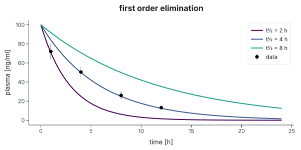
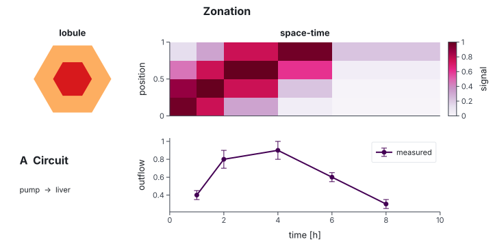
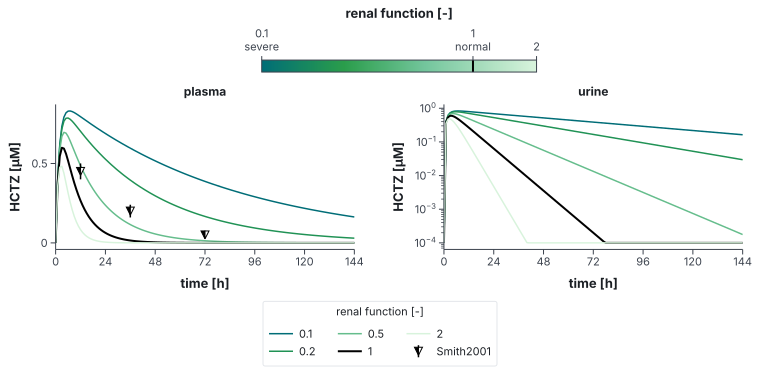
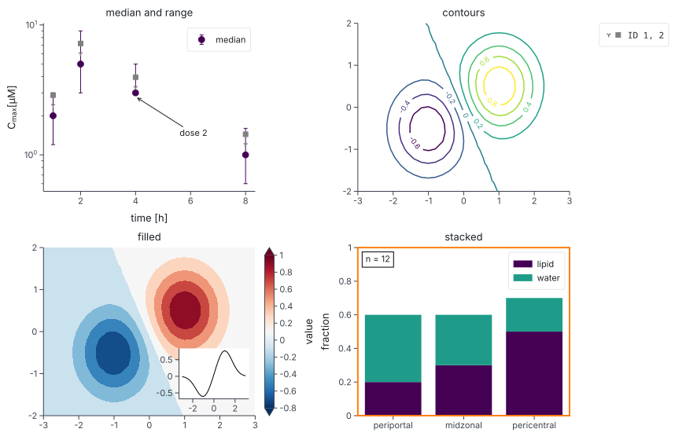
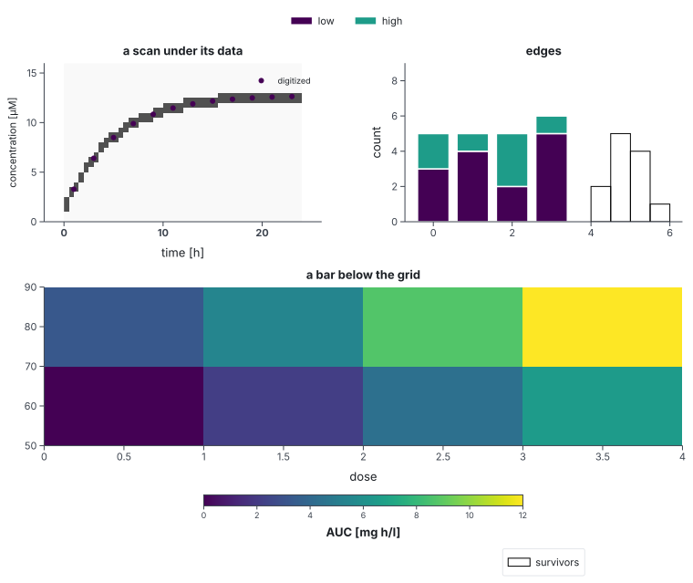

# Charts

`sbmlsim_core.chart` builds the figures of the contract [figure/1](plot.md#the-contract-figure1) in python: a `Chart` is a grid of plots, and its spec is drawn by the renderer of the package, `sbmlsim_core.render_svg` and `render_png`. It is the chart builder of [sbmlsim](https://matthiaskoenig.github.io/sbmlsim/plotting/), which re-exports it as `sbmlsim.plot.Chart`, and it is here so that a package which sbmlsim depends on draws charts as well. The module is pure python and needs numpy only, as the package does: quantities of [pint](https://pint.readthedocs.io) and data arrays of [xarray](https://docs.xarray.dev) are read when they are given, and neither is imported by the chart.

## The chart builder

A `Chart` is a grid of plots, `chart.plot(row, column, x=..., y=...)` adds one, and the methods of a plot add elements: `curve` (lines, markers and error bars), `band`, `area`, `bar`, `box`, `violin`, `histogram`, `heatmap`, `contour`, `text`, `arrow`, `rule`, `polygon` and `colorbar`. Each returns the id of its element. The data are sequences, numpy arrays, quantities or data arrays. An axis, `ChartAxis(label=..., unit=...)`, converts the quantities on it to its unit, takes the unit of the first quantity when it has none and takes the `name` of a data array as its label, and the renderer shows it as `<label> [<unit>]`, the unit in the short form of pint (`h` for `hr`, `ng/ml` for `nanogram / milliliter`, `sbmlsim_core.chart.short_unit`). A chart is saved by the suffix of its path, `.svg`, `.png` (with `dpi=`) or `.json`, its spec; every file is written atomically:

```python
import numpy as np

from sbmlsim_core.chart import Chart, ChartAxis

time = np.linspace(0, 24, 97)
chart = Chart(width=600, height=300, title="first order elimination")
plot = chart.plot(
    x=ChartAxis(label="time", unit="hr"), y=ChartAxis(label="plasma", unit="ng/ml")
)
for half_life in (2.0, 4.0, 8.0):
    plot.curve(time, 100 * 0.5 ** (time / half_life), label=f"t½ = {half_life:g} h")
plot.curve(
    [1, 4, 8, 12],
    [72.0, 50.5, 26.0, 13.2],
    yerr=[8.0, 6.0, 4.0, 2.0],
    line="none",
    marker="circle",
    color="black",
    label="data",
)
chart.save("elimination.svg")
chart.save("elimination.png", dpi=200)
chart.save("elimination.json")
```



A plot can have several colour bars: every `plot.colorbar(scale, low, high, label=...)` adds one, stacked right of the panel. A bar takes the part of its colour map it shows (`start`, `end`, from 0 to 1), its `ticks` and their `tick_labels`, and `categorical=True` draws one band per integer from `low` to `high`, labelled by `tick_labels`. `chart.plot(legend_swatches={group: {...}})` draws the swatch of a legend group in a style of its own, the style keywords of `curve`, e.g. the middle colour of lines which differ in colour. A text, a title or a label breaks its lines at `\n`, a tick label too. The fonts of a chart take the sizes `title`, `label`, `tick`, `tick_y` (the y axes and the colour bars), `legend` and `plot_title` (the titles of the plots, `label` without) and the weights `title_weight`, `label_weight`, `tick_weight` and `legend_weight`, `normal` or `bold`: `Chart(fonts={"label": 13, "label_weight": "bold"})`.

A heat map and a colour bar take the sequential and the diverging colour maps of matplotlib by their names, in the case of matplotlib or in lower case (`Blues`, `Reds`, `PuRd`, `YlOrRd`, `RdBu`, ...), each also reversed (`Blues_r`); `sbmlsim_core.COLOR_SCALES` lists them, and a value has the colour matplotlib gives it. A heat map places its cells on the categories of its axes, or with `x_edges` and `y_edges` between edges on numeric axes, which stay numeric, so a space-time heat map shares its time with a curve below it. `ChartAxis(line_visible=False)` hides the line of an axis, and `chart.plot(aspect="equal")` makes a unit of y as long as a unit of x by widening the limits of one axis, so a lobule is a regular hexagon without measuring the panel. Error bars take caps of a length in pixels (`error_cap=`), a text its `size` and `weight`, and a text keeps its runs of spaces. The panel of a plot is at least 20 pixels over its span, so a grid of many thin columns fits its chart as long as its plots span several of them:

```python
import numpy as np

from sbmlsim_core.chart import Chart, ChartAxis

hidden = ChartAxis(label_visible=False, ticks_visible=False, line_visible=False)
chart = Chart(width=720, height=360, rows=2, columns=3, title="Zonation")
lobule = chart.plot(
    0, 0, title="lobule", x=hidden, y=hidden, aspect="equal", legend=False
)
angles = np.linspace(0, 2 * np.pi, 7)[:-1]
for radius, color, zone in [
    (1.0, "#fdae61", "periportal"),
    (0.5, "#d7191c", "pericentral"),
]:
    ring = np.column_stack([radius * np.cos(angles), radius * np.sin(angles)])
    lobule.polygon([ring], line="none", fill=color, fill_opacity=1.0, label=zone)

time = ChartAxis(label="time", unit="hr", min=0, max=10)
space_time = chart.plot(
    0,
    1,
    column_span=2,
    title="space-time",
    x=ChartAxis(min=0, max=10, ticks_visible=False),
    y=ChartAxis(label="position"),
    legend=False,
)
edges = np.array([0, 1, 2, 4, 6, 10])
position = np.linspace(0, 1, 5)
signal = np.exp(-(((edges[:-1] + edges[1:]) / 2 - 6 * position[:-1, None]) ** 2) / 8)
space_time.heatmap(None, None, signal, x_edges=edges, y_edges=position, scale="PuRd")
space_time.colorbar("PuRd", 0, 1, label="signal")

blank = ChartAxis(
    label_visible=False, ticks_visible=False, line_visible=False, min=0, max=1
)
note = chart.plot(1, 0, x=blank, y=blank, legend=False)
note.text(0.05, 0.7, "A  Circuit", size=16, weight="bold")
note.text(0.05, 0.3, "pump  ->  liver")

outflow = chart.plot(1, 1, column_span=2, x=time, y=ChartAxis(label="outflow"))
outflow.curve(
    [1, 2, 4, 6, 8],
    [0.4, 0.8, 0.9, 0.6, 0.3],
    yerr=[0.05, 0.1, 0.1, 0.05, 0.05],
    error_cap=8,
    marker="circle",
    label="measured",
)
chart
```



A colour map is a name or the colours of a map at positions, `[(0.0, color), (0.3, color), ..., (1.0, color)]`, as matplotlib's `LinearSegmentedColormap.from_list`, wherever a scale is taken (`colorbar`, `heatmap`). A colour bar takes `marks`, lines across it at values such as the default of the scan, and goes right of its panel (`placement="right"`), above the panels of its row (`"top"`, centred over them, `length` its share of their width, matplotlib's `shrink`, and `thickness` in pixels) or into its panel (`"inset"`, at a `loc` of the legend locations, which a legend at `best` goes around). An axis takes the values of its `ticks` and their `tick_labels`, so a time axis ticks every 24 hours; the renderer writes the decades of a log axis as powers of ten and the ticks of large or small values with a multiplier at the end of the axis, as matplotlib. A curve takes the markers of matplotlib (`MARKERS`: `triangle_down`, `star`, `x_filled`, `thin_diamond`, ...), half filled with `marker_fill_style` (`left`, `right`, `bottom`, `top`) and the fill of the other half `marker_fill_alt`, and the width of its error bars, `error_width`; a box its width, `box_width`. A plot takes a `legend_title` and `legend_columns` (matplotlib's `ncol`, inside or outside), and a chart a legend below the grid, `Chart(legend_position="bottom", legend_columns=3, legend_title=...)`, of the entries of all plots. A text takes `family="monospace"`, every character 0.6 of its size wide, so a table of lines padded with spaces keeps its columns; the signs of units (`mg⋅l⁻¹`, `µmol·min⁻¹`, `±`, `≤`) are measured and drawn in every format:

```python
import numpy as np

import sbmlsim_core
from sbmlsim_core.chart import Chart, ChartAxis

stops = [(0.0, "#006d77"), (0.3, "#2a9d4b"), (0.6, "#74c69d"), (1.0, "#d8f3dc")]
factors = [0.1, 0.2, 0.5, 1.0, 2.0]
colors = sbmlsim_core.color_scale(stops, 0.1, 2.0, factors, log=True)
hours = np.linspace(0, 144, 145)
chart = Chart(
    width=760,
    height=300,
    columns=2,
    fonts={"label_weight": "bold", "plot_title": 12},
    legend_position="bottom",
    legend_columns=3,
    legend_title="renal function [-]",
)
time = ChartAxis(label="time", unit="hr", min=0, max=144, ticks=range(0, 145, 24))
plasma = chart.plot(0, 0, title="plasma", x=time, y=ChartAxis(label="HCTZ", unit="µM"))
urine = chart.plot(
    0, 1, title="urine", x=time, y=ChartAxis(label="HCTZ", unit="µM", scale="log")
)
for factor, color in zip(factors, colors, strict=True):
    ke = 0.12 * factor
    cp = 0.9 * 0.6 / (0.6 - ke) * (np.exp(-ke * hours) - np.exp(-0.6 * hours))
    width = 2.0 if factor == 1.0 else 1.5
    style = {"color": "black" if factor == 1.0 else color, "width": width}
    plasma.curve(hours, cp, label=f"{factor:g}", legend=f"{factor:g}", **style)
    urine.curve(hours, np.maximum(cp, 1e-4), legend=f"{factor:g}", **style)
plasma.curve(
    [12, 36, 72],
    [0.45, 0.2, 0.05],
    yerr=[0.05, 0.04, 0.02],
    error_width=1.5,
    line="none",
    marker="triangle_down",
    size=8,
    marker_fill_style="left",
    marker_fill_alt="white",
    color="black",
    label="Smith2001",
    legend="data",
)
plasma.colorbar(
    stops,
    0.1,
    2.0,
    log=True,
    label="renal function [-]",
    ticks=[0.1, 1, 2],
    tick_labels=["0.1\nsevere", "1\nnormal", "2"],
    marks=[1.0],
    placement="top",
    length=0.4,
)
chart
```



Since 0.33.0 error bars take their two sides apart, `yerr=(low, high)` or `{"low": ..., "high": ...}`, a value which is not finite a side which is not drawn, so a median with its quantiles or an SD above the mean alone is drawn as matplotlib draws it. `plot.contour(x, y, values, levels, scale=..., labels=True)` draws contour lines with their labels inline, as matplotlib's `contour` and `clabel`, and with `filled=True` the bands between the levels, as `contourf`; a scale takes `gamma`, matplotlib's `PowerNorm`. `plot.arrow(x, y, x_from, y_from, text=...)` draws an arrow from a tail to a head, matplotlib's `annotate`, with an `open`, a `filled` or no `head`, or a filled arrow with a `body`. A text takes a `rotation`, a vertical anchor `baseline`, a `box` behind it and a `loc` in a corner of the panel (matplotlib's `AnchoredText`); every text draws `_{...}` as a subscript and `^{...}` as a superscript. A curve, a polygon, a text and an arrow take `coordinates="axes"`, fractions of the panel, and `clip=False`, drawn over the whole figure, e.g. the slashes of a broken axis. `chart.plot(inset=(host, (x, y, width, height)))` puts a plot into the panel of another one (matplotlib's `inset_axes`), `frame_color` and `frame_width` draw all four sides of a panel, `x2=ChartAxis(...)` a second x axis on top (`twiny`) and `ChartAxis(tick_label_color=...)` colours the tick labels, one colour or one per tick. Bars and histograms stack on their `base` (matplotlib's `bottom`), a histogram draws its bars without seams, a box takes the colour of its median and the opacity of its whiskers, and the markers `octagon` and `tri_down`, `tri_up`, `tri_left`, `tri_right` join the others. A plot takes further `legends` of the groups they list (each with its `title` and `loc`), a `legend_anchor` (matplotlib's `bbox_to_anchor`) and `legend_tuples`, groups whose swatch shows the markers of all their elements; a chart takes `legends` of the figure, right of the grid or below it, and `row_titles`, and its fonts `plot_title_weight`, `colorbar_label` and `legend_family`. A colour bar takes triangles at its ends (`extend`), spans `rows` of the grid, and goes along the top of its panel as a strip (`placement="strip"`) or in place of the panel (`"panel"`). A log axis has the ticks of matplotlib, its decades as powers of ten and its minor ticks, and a legend at `best` takes the place matplotlib takes:

```python
import numpy as np

from sbmlsim_core.chart import Chart, ChartAxis

chart = Chart(
    width=760,
    height=560,
    rows=2,
    columns=2,
    fonts={"plot_title_weight": "normal"},
    legends=[{"groups": ["individuals"], "position": "right", "family": "monospace"}],
)
data = chart.plot(
    0,
    0,
    title="median and range",
    x=ChartAxis(label="time", unit="hr"),
    y=ChartAxis(label="C_{max}", unit="µM", scale="log"),
    legend_tuples=["individuals"],
)
data.curve(
    [1, 2, 4, 8],
    [2.0, 5.0, 3.0, 1.0],
    yerr=([0.8, 2.0, np.nan, 0.4], [1.0, 4.0, 2.0, 0.6]),
    error_cap=5,
    line="none",
    marker="octagon",
    size=8,
    label="median",
)
for k, marker in enumerate(["tri_down", "square"]):
    data.curve(
        [1, 2, 4, 8],
        np.array([2.4, 6.0, 3.3, 1.2]) * (1 + 0.2 * k),
        line="none",
        marker=marker,
        color="grey",
        label="ID 1, 2",
        legend="individuals",
    )
data.arrow(4, 2.8, 5.6, 1.4, text="dose 2", head="open", width=1)

x = np.linspace(-3, 3, 31)
y = np.linspace(-2, 2, 21)
values = np.exp(-np.add.outer((y - 0.5) ** 2, (x - 1) ** 2))
values -= 0.8 * np.exp(-np.add.outer((y + 0.5) ** 2, (x + 1) ** 2))
levels = [-0.6, -0.4, -0.2, 0.0, 0.2, 0.4, 0.6, 0.8]
lines = chart.plot(0, 1, title="contours", legend=False)
lines.contour(x, y, values, levels, scale="viridis", labels=True, label_size=9)
bands = chart.plot(1, 0, title="filled", legend=False)
bands.contour(x, y, values, np.linspace(-0.8, 1.0, 10), filled=True, scale="RdBu_r")
bands.colorbar("RdBu_r", -0.8, 1.0, extend="both", label="value")
inset = chart.plot(inset=(bands, (0.64, 0.1, 0.33, 0.3)), legend=False)
inset.curve(x, values[10], color="black", width=1)

fat = chart.plot(
    1,
    1,
    title="stacked",
    x=ChartAxis(scale="category", categories=["periportal", "midzonal", "pericentral"]),
    y=ChartAxis(label="fraction", min=0, max=1),
    frame_color="tab:orange",
    frame_width=2,
)
fat.bar(["periportal", "midzonal", "pericentral"], [0.2, 0.3, 0.5], label="lipid")
fat.bar(
    ["periportal", "midzonal", "pericentral"],
    [0.4, 0.3, 0.2],
    base=[0.2, 0.3, 0.5],
    label="water",
)
fat.text(None, None, "n = 12", loc="upper left")
chart
```



Since 0.34.0 `plot.image(image, (x0, x1, y0, y1))` draws a raster image over a rectangle of the axes, matplotlib's `imshow` with its `extent`, `origin` and `interpolation`, under the other elements of the plot, e.g. the scan of a figure of a study under the data digitized from it: the bytes of a PNG, its base64, or an RGB(A) array of bytes or of shares of 1 (`sbmlsim_core.image_png`), embedded in the SVG and drawn in the PNG. Every element takes `z`, matplotlib's `zorder`, which orders the elements of both y axes together. Bars and histograms take `edge_color` and `edge_width` (white edges between stacked bars), and the legend shows the edge of a bin; a box takes `median_opacity`. A legend of the figure goes above the grid (`position="top"`) and under or over a `column` of the grid, every legend takes its `size`, `weight` and `frame` (`legend_size`, `legend_weight`, `legend_family` and `legend_frame` of a plot, matplotlib's `fontsize` and `frameon`), and a `legend_anchor` beyond the panel reserves its room. A colour bar goes below the panels of its row (`placement="bottom"`) and puts its ticks on the `tick_side` it is given, the fonts take `colorbar_tick` and `colorbar_label_weight`, and an axis takes its `tick_weight` and `label_size`:

```python
import numpy as np

from sbmlsim_core.chart import Chart, ChartAxis

chart = Chart(
    width=760,
    height=560,
    rows=2,
    columns=2,
    fonts={"colorbar_tick": 9, "colorbar_label_weight": "bold"},
    legends=[
        {"groups": ["low", "high"], "position": "top", "columns": 2, "frame": False},
        {"groups": ["survivors"], "position": "bottom", "column": 1},
    ],
)
rows, columns = np.mgrid[0:32, 0:48]
curve = 28 - 22 * (1 - np.exp(-columns / 10))
page = np.where(np.abs(rows - curve) <= 1, 0.15, 0.97)
scan = np.repeat(page[:, :, None], 3, axis=2)
study = chart.plot(
    0,
    0,
    title="a scan under its data",
    x=ChartAxis(label="time", unit="hr", tick_weight="bold"),
    y=ChartAxis(label="concentration", unit="µM", label_size=11),
    aspect="equal",
    legend_frame=False,
    legend_size=9,
)
study.image(scan, (0, 24, 0, 16), opacity=0.8)
hours = np.arange(1, 24, 2.0)
study.curve(
    hours,
    16 - (28 - 22 * (1 - np.exp(-(2 * hours - 0.5) / 10)) + 0.5) / 2,
    line="none",
    marker="circle",
    size=5,
    label="digitized",
)

stack = chart.plot(0, 1, title="edges", y=ChartAxis(label="count", max=9))
stack.bar(
    [0, 1, 2, 3],
    [3, 4, 2, 5],
    edge_color="white",
    edge_width=1.5,
    label="low",
    legend="low",
)
stack.bar(
    [0, 1, 2, 3],
    [2, 1, 3, 1],
    base=[3, 4, 2, 5],
    edge_color="white",
    edge_width=1.5,
    label="high",
    legend="high",
)
stack.histogram(
    [4, 4.5, 5, 5.5, 6],
    [2, 5, 4, 1],
    color="white",
    edge_color="black",
    label="survivors",
    legend="survivors",
)

doses = chart.plot(
    1, 0, column_span=2, title="a bar below the grid", x=ChartAxis(label="dose")
)
doses.heatmap(
    None,
    None,
    [[1, 3, 5, 7], [4, 6, 9, 12]],
    x_edges=[0, 1, 2, 3, 4],
    y_edges=[50, 70, 90],
    scale="viridis",
)
doses.colorbar("viridis", 0, 12, placement="bottom", length=0.5, label="AUC [mg h/l]")
chart
```



A chart shows itself in a notebook, where its SVG is the last expression of a cell. The SVG is the default format of the package, the PNG takes a `dpi` (the resolution is stored in the PNG), and the JSON is the spec of the contract `figure/1`, `chart.spec()` as a dictionary, which `sbmlsim_core.render_svg` and the renderer of the JavaScript host draw again. A value which is not finite is a gap in a curve, `null` in the JSON.


## Quantities and data arrays

The chart reads quantities and data arrays by duck typing, so neither pint nor xarray is a dependency of the package:

- a quantity is an object with `to(unit)`, `magnitude` and `units`, a quantity of pint among them. It is converted by its own registry, `quantity.to(unit)` with the unit of the axis as text, so the units of the registry it was made with are known, those a package defines in a registry of its own included. A quantity of another dimension than its axis raises the `DimensionalityError` of its registry, which names the axis.
- a data array is an object with `values`, `dims` and `attrs`, a `xarray.DataArray` among them, and `attrs["units"]` is its unit. A data array on an axis of its unit, or on an axis without a unit, which it gives its unit, is taken as it is; one of another unit is converted with the application registry of pint (`pint.get_application_registry()`, which a package with a registry of its own sets with `pint.set_application_registry`), so this conversion needs pint, and without pint it raises a `ValueError` which says so.
- an axis unit the registry of a quantity does not know is shown as given and takes no quantity, e.g. an international unit of a substance.

```python
import pint

ureg = pint.UnitRegistry()
glucose = Chart(width=400, height=260)
plot = glucose.plot(x=ChartAxis(label="time", unit="hr"), y=ChartAxis(label="glucose"))
plot.curve(
    ureg.Quantity([0, 30, 60, 120], "min"), ureg.Quantity([5.0, 8.2, 7.1, 5.6], "mM")
)
plot.spec()["y"]["unit"]  # "mM", the unit of the first quantity
```

The labels of the units are formatted without pint as well: `short_unit` reads the expressions of pint, its long form (`milligram / kilogram / day`) and the short one (`mg/kg/d`, `mg/(kg*d)`, `m**2`, `1/hour`), with the prefixes and the units of pharmacokinetics and physiology, and writes the form `f"{unit:~P}"` of pint (`mg/d/kg`, `m²`, `1/h`). A unit it does not read, one with a factor (`ml/min/(1.73*m**2)`) or a unit of a model, is shown as given.

## Colours

The chart takes the colour names of matplotlib, without matplotlib (`sbmlsim_core.chart.colors`): a CSS name (`dimgrey`), a base colour of one letter (`k`), a tableau name (`tab:red`), an xkcd name (`xkcd:sky blue`), a colour of the default cycle (`C0` to `C9`, `CYCLE`), hex (`#rgb`, `#rrggbb`, with an alpha `#rrggbbaa`), a grey level as a text (`"0.4"`) and a tuple of floats. The spec holds `#rrggbb`: `normalize_color` converts a name, and an alpha of the colour (`color_alpha`) is multiplied into the opacity of the element or of its fill. `marker_fill="none"` draws a hollow marker, its edge alone.

## Thinning

A curve of a simulation carries every step of the integrator, thousands of points for a line a few hundred pixels long. `Chart.spec`, and so the JSON and the SVG, thins the lines of the curves, bands and areas to the points which are visibly apart (`sbmlsim_core.chart.thinning`, the algorithm of Ramer, Douglas and Peucker in the coordinates of the panel): a point is left out only when it is within `THIN_TOLERANCE` (1e-4) of the span of the axes of the line drawn without it, a tenth of a pixel of a large panel. The first and the last point, the gaps, the extremes of every column and the points of a curve with markers or error bars are kept, so the limits and the ticks of the axes do not move. `Chart(thinning=None)` keeps every point, `thinning=1e-3` thins more.
